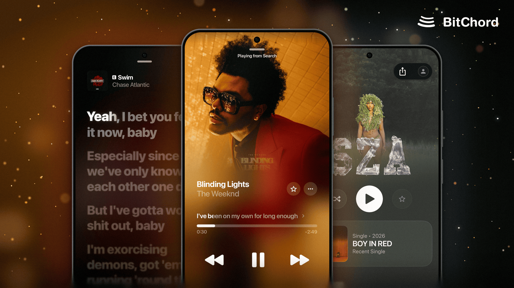

# BitChord-X 1.10.1

A polish release on top of 1.10.0: better search results, custom album artwork, a cleaner player, safer
scrobbling and a lot of internal clean-up.

## Highlights

- **Custom album and playlist artwork.** Crop your own square cover and add a transparent title logo.
- **Smarter search.** Catalogue tracks come first, user-uploaded noise in other languages is filtered out, and DJ
  sets get their own sections.
- **A calmer player.** The like star and the "..." menu are drawn as bare glyphs, and holding the star saves the
  song to a playlist.
- **Desktop keyboard shortcuts** with a cheat sheet.
- **Every view is translated**, on the phone and on the PC.

## Player and interface

- The like star and the menu beside the track title lose their round disc and are slightly larger, in both
  orientations and on the PC. The liked state still shows in the star's shape.
- Holding the star opens the usual **Add to playlist** sheet for the song that is playing, on the phone and on the
  PC. A tap still likes.
- Albums and playlists can use a custom square cover, cropped with pinch, pan and zoom, and a transparent title
  logo. Release pages show official artist logos, and the editing actions share one sheet.
- Swiping between tabs in the library loops around, and the dock transitions are coherent.
- The player releases the window focus and ends the overshoot tail when it closes.
- The mini player hides the local device caption and shows the party in the player controls.
- Explore opens faster because its ordering and live feed are computed before the first visit.
- The configured onboarding name is preferred for the greeting, with Google and localised fallbacks.

## Search

- Catalogue tracks are ranked first.
- User-generated uploads in other languages are filtered out of the results.
- DJ sets appear in their own sections.

## Desktop

- Standard PC keyboard shortcuts and a cheat sheet dialog.
- The artist "About" section matches the phone's design.
- The Connect button no longer keeps a grey hover layer or ripple after its panel closes.
- Listen Together sits on a solid card with no blur behind it, and the Connect panel is sized for a pointer.
- Tabs in the library use the current Material tab row.

## Connect and Listen Together

- Playing an album, playlist or artist works from a phone that is another device's remote.
- If the remote device disconnects, the app goes back to the local device and tells you.
- "View party" uses the same filled capsule as "Start a party".

## Audio and playback

- The audio pipeline keeps its telemetry, source inspection and upgrade state consistent.
- The song cache is read once, so an eviction can no longer crash a queue.
- Playback no longer runs out of memory in the tapping audio sink.
- Automix model downloads that are cancelled are not logged as failures.
- Statistics and artist-fact warnings now reach Logcat.

## Scrobbling

- API errors are handled gracefully instead of failing silently, and the ListenBrainz token is sanitised.

## Translations

- All mobile and desktop views are localised, and the string resources are in sync across languages.
- Explore daily themes, live stations and the "best part" label are translated into 17 languages.

## Under the hood

- Unused imports, parameters, dead classes and always-true conditions were removed across every module.
- A dead-code check was added: `./gradlew detekt` and `python scripts/unused_imports.py`.
- The desktop build number is Android's version code, so both stay in step.
