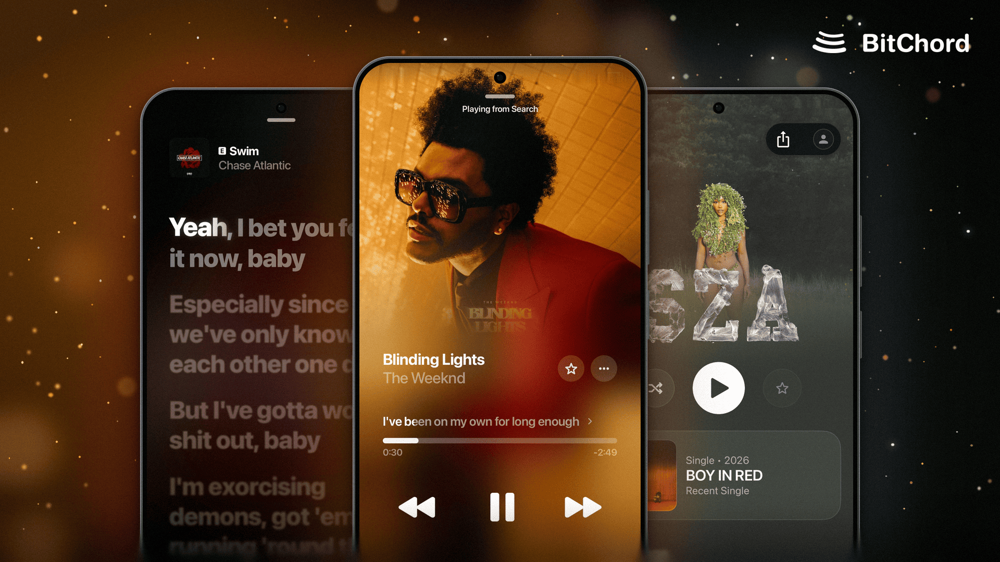

# BitChord-X 1.10.2

A beta of the next release: the Spotify import to YouTube Music, rebuilt, and steadier connections to the
BitChord server.

## Highlights

- **Spotify to YouTube Music, done properly.** Importing your Spotify library to your YouTube Music account now shows
  its progress, survives leaving the app and says what went wrong.
- **Your Spotify Liked Songs, your choice.** Add them to your YouTube likes, or keep them in a playlist of their own.
- **Fewer dropped connections** to the BitChord server for parties, presence and your account.

## Spotify import

- Importing playlists from your Spotify library to YouTube Music uses the same bar as importing to the device. It
  shows each playlist being read, matched, added or liked, with a Cancel button.
- The import keeps going in the background with a notification that shows its progress and has a Cancel button. When
  it ends, a notification says how it went.
- If your Spotify or YouTube Music sign-in expires, the import stops and offers to sign you in again. If YouTube asks
  to slow down, it waits and tries again before stopping, and what was already added stays.
- A playlist that fails doesn't stop the others. Try again retries only the ones that failed.
- Importing again only sends the songs that are missing, and playlists already on your account are marked as such.
- When Liked Songs is among what you import to YouTube Music, you're asked whether to like the songs on YouTube or
  save them as a separate playlist.
- Liked Songs saved on the device, or as a separate playlist, get a green version of the liked cover.
- Creating a YouTube Music playlist with more than 50 songs retries a batch that fails, and says how many songs
  couldn't be added instead of losing them silently.

## Connections

- The presence and account connections wait longer after each failed attempt, instead of reconnecting every few
  seconds, and follow the server's Retry-After.
- The server allows more presence connections per network, so several phones behind the same carrier IP don't lock
  each other out.
- Invite links are put last in the shared message, and a code with text glued after it still opens the invite.

This is a beta: install it over 1.10.1 to try it. You'll be offered 1.10.2 when it's released.
